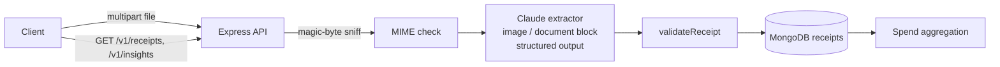

# receipt-vision-extractor

Turn receipt photos and PDFs into validated structured data with Claude vision, stored in MongoDB.

[](https://github.com/Muhaman/receipt-vision-extractor/actions/workflows/ci.yml)

## What it does

- Accepts a receipt as JPEG, PNG, WebP or PDF (up to 5 MB) and asks Claude to extract merchant, date, currency, line items, subtotal, tax, total and a spend category.
- Output is constrained to a zod schema through structured outputs, so the API never returns free-form text.
- Cross-checks the arithmetic and the date and returns warnings (`line_items_mismatch`, `total_mismatch`, `suspicious_date`) instead of silently trusting the model.
- Persists receipts in MongoDB, lists them with cursor pagination and aggregates spend by category or month.
- Ships a small upload page at `/` for trying it out.

## Architecture



## Quickstart

```bash
cp .env.example .env        # set ANTHROPIC_API_KEY
docker compose up --build   # app on http://localhost:3000, MongoDB included
```

Without Docker, run a local MongoDB and `npm install && npm run dev`. The process fails at startup naming any missing variable (`ANTHROPIC_API_KEY`, `MONGODB_URI`).

## Usage

```bash
# Extract a receipt
curl -F file=@receipt.png http://localhost:3000/v1/receipts
# {"id":"...","receipt":{"merchant":"...","date":"2025-03-14","currency":"USD",...},"warnings":[]}

# List (newest first), then follow the cursor
curl "http://localhost:3000/v1/receipts?limit=20"
curl "http://localhost:3000/v1/receipts?limit=20&cursor=<nextCursor>"

# One receipt (400 for a malformed id, 404 if missing)
curl http://localhost:3000/v1/receipts/<id>

# Spend per (category|month, currency), largest first
curl "http://localhost:3000/v1/insights/spend?by=category"
```

Errors are JSON: `{ "error": { "code", "message" } }`. Wrong file type is 415, over 5 MB is 413, empty file is 400, and a model refusal or truncated output is 502 (`refusal`, `max_tokens`).

## Design decisions & trade-offs

- **Structured outputs over prompt-and-parse.** `messages.parse` with a zod output format guarantees the shape; the validator then checks the semantics (sums, dates) that a schema cannot express.
- **Warnings, not rejections.** A receipt that fails arithmetic checks is still stored, with its warnings, so a human can review it rather than losing the extraction.
- **Magic-byte MIME checks.** The client-declared type is only a first filter; the real type is sniffed from the bytes and is what gets sent to Claude.
- **Spend grouped by currency.** Aggregation groups on `(key, currency)` so amounts in different currencies are never added together; no FX conversion is attempted.
- **Cursor on `_id`.** Pagination is stable under inserts and needs no extra index beyond the default `_id`; a `{createdAt: -1}` index backs time-ordered queries.
- **Refusal handling.** The call opts into server-side refusal fallback; if the final stop reason is still `refusal`, the API returns an explicit 502 instead of an empty 200.

## Testing

```bash
npm install
npm run lint && npm run typecheck && npm test
```

Tests use a fake extractor and `mongodb-memory-server` (downloads a `mongod` binary on first run), so no API key is needed. The upload fixture is a 1x1 PNG built in test code; no receipt images are committed and all sample data is synthetic.

## Limitations & next steps

- One receipt per file; multi-page PDFs are sent whole and treated as a single receipt.
- Extraction accuracy depends on image quality and has not been benchmarked here.
- No authentication or per-user ownership; add both before exposing it publicly.
- No currency conversion, deduplication of re-uploaded receipts, or manual correction endpoint.

## License

MIT
